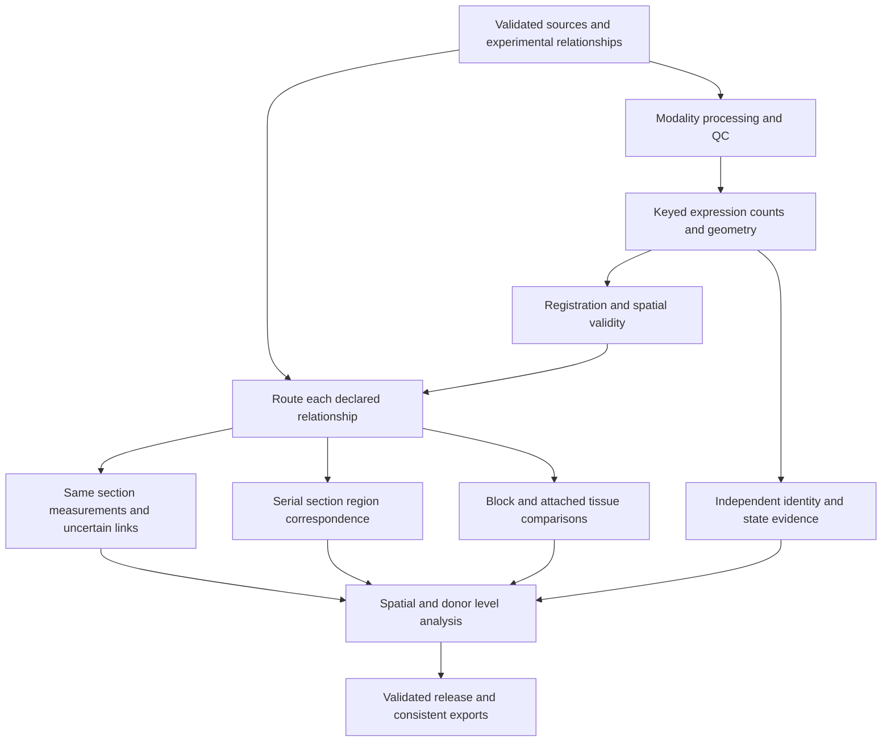

# Unified PhenoCycler and Xenium workflow plan

Plan date: 2026-10-08. Status: proposed implementation sequence, based on the [pipeline audit](PIPELINE_AUDIT_2026-10-08.md) and [repository evaluation](REPOSITORY_EVALUATION_2026-10-08.md).

Build the cohesive workflow in Islet Explorer Senior by recovering its useful numerical and scientific components, adding an acquisition-aware data contract, and replacing fragmented orchestration with one CLI-backed execution graph. Use Snakemake for local and Slurm execution, parameterized notebooks for reviewing every checkpoint, and immutable artifacts that bind each result to its actual inputs, code, parameters, environment, and spatial transform. The first deliverable should be a reliable small-cohort processing workflow; biological typing and multimodal models advance through separately visible validation checkpoints.

At the initial audit checkpoint, the existing pipeline could not safely serve as an end-to-end reference run. It had verified restart, environment, section-key, release-publication, notebook, and coordinate-consistency defects. The newer v3 checkout contained recoverable advances and substantial dirty work, and its October 6 typing checkpoint declared validation incomplete. Preserve all generations and reconcile them before rebuilding data.

Later October 8 work completed corrected protein/RNA typing generations, full-row releases, admission/display/composition consumers and scoped review figures in v3. Adopt their exact generation receipts and uncertainty contracts as documented in the [current typing review](/home/smith6jt/IO60panc2nd/Islet-Explorer-Senior-v3/results/v3/islet_immune_reassessment_20261006/cell_typing_validation/current_cohesive_typing_review_20261008/CURRENT_CELL_TYPING_REVIEW.md). This advances the recovered typing stage; the public CLI, single execution graph, site-specific HPC smoke run and shared stage notebooks described below remain implementation work. Independent biological accuracy has not been established, and production aliases remain unpromoted.

## Experimental designs and supported comparisons

The user clarified that the attached lymphatic/pLN region of interest is physically part of the pancreas section: both tissues came from the **same block and the same section**. Encode this directly, with distinct annotated tissue ROIs and their boundary geometry. Do not infer this physical relationship merely from two annotations appearing in one image. The existing [IO60panc2nd Notes.md](../IO60panc2nd%20Notes.md) and parent-project annotation/block ledger also record explicitly separate-block tissue pieces on some slides; retain those recorded distinctions per annotation and acquisition.

Slide carrier, block origin, physical section, tissue ROI, acquisition order, and modality are independent attributes. “Same slide” alone is insufficient to determine how two assays should be integrated.

| Design | Required physical evidence | Integration output | Supported analysis |
|---|---|---|---|
| Post-Xenium IF | Same section, Xenium bundle, IF acquisition, named antibody channels, registration validity | IF measured inside transformed native Xenium polygons, with keyed cells and coverage/error fields | Per-cell RNA–protein associations for successfully measured markers; failed stains remain unavailable |
| PhenoCycler followed by Xenium on the same section | Explicit acquisition identities and assay order, reviewed registration | Native protein and RNA tables; direct protein sampling in Xenium polygons where appropriate; separate segmentation-overlap link table | Per-cell evidence where geometry supports it, with unmatched and ambiguous cells retained |
| Sequential sections measured on the two platforms | Block identity, section/cutting order, thickness and available separation, homologous tissue ROIs | Matched tissue/islet/region objects with registration and correspondence uncertainty | Regional composition, spatial gradients, structure-level concordance; cell similarity links remain inferred |
| Same block with pancreas and attached lymphatic/pLN tissue in one section | User-confirmed origin plus annotation IDs and geometries | Separate tissue ROI tables and a shared physical section frame | Tissue-specific analysis, paired donor/block comparisons, and interface distances when geometry is contiguous and valid |
| Same block with different tissue ROIs on different sections | Explicit block/component origins and section identities | Separate frames with block-level pairing | Paired tissue/block summaries; physical adjacency requires additional geometric evidence |
| Explicitly different blocks mounted on one slide | Block identity for each piece and slide-region mapping | Independent specimen/region observations that share acquisition metadata | Donor-paired tissue comparisons and acquisition QC; mounting proximity is not anatomical proximity |

Keep `same_section`, `serial_section`, `same_block`, and `shared_slide` as independent relationships. Record unknown relationships as `unknown` with a reason. Support either assay order on a common section; PhenoCycler→Xenium and Xenium→IF must retain their separate chemistry and acquisition effects. The same-section IF path is supported by the [10x post-Xenium protocol](https://cdn.10xgenomics.com/image/upload/v1695848849/support-documents/CG000709_Post-Xenium_TechnicalNote_RevA.pdf); the actual stain and registration performance still need evaluation for each section.

## Components to retain and adapt

| Function | Proposed foundation | Required adaptation |
|---|---|---|
| Canonical project and scientific record | Senior, recovered v3 changes, preserved Phenocycler history | Reconcile code and artifact generations; identify the exact producer of each retained release |
| Raw multiplex image processing | Current KINTSUGI CLI and image workflow | Pin a reviewed commit, package the callable methods, add strict input/output receipts, and test incomplete/failed channel behavior |
| DAG and execution profiles | Snakemake with local and Slurm profiles | One project-level graph for imaging, RNA, integration, reports and exports; stage resources and site settings outside scientific configuration |
| Workflow design reference | MCMICRO | Reuse module/container/input conventions; avoid maintaining parallel Nextflow and Snakemake implementations |
| Image IO | pyvips and OME-TIFF; OME-Zarr where useful | Explicit axes, channel IDs, pyramids, calibration, chunking and native-library versions |
| Segmentation and authoring | QuPath plus the reviewed InstanSeg model | Version model weights and exports; headless reproducible processing plus saved human review; preserve native UUIDs |
| Protein quantification | Senior geometry, compartment measurements and CPU REDSEA | Retain acquired-but-unavailable markers, exact cell universe and source mapping; test upstream parity and chunk boundaries |
| RNA ingest and analysis | Native Xenium outputs, SpatialData IO, Scanpy and the declared Senior RNA producers | Section-aware keys, raw counts, panel coverage, complete releases and explicit naming uncertainty |
| Protein alignment | Pinned UniFORM and v3 block/reference-donor adapters | Define the reference population per block/tissue/marker; retain unaligned values and quantify bright-cell distortion |
| Registration | VALIS seed plus Senior refinement and registered-export contracts | Use the same transform artifact for polygons, features, overlays and links; validate direction and withheld spatial landmarks |
| Spatial analysis | Squidpy and existing Senior distance/region modules | One graph contract, boundary handling and donor-level summaries; optional UTAG/BANKSY/barrier-aware backends |
| Review and delivery | Shared notebook API, ieCore/Shiny, TissUUmaps/Viv exporters | Consume one declared release; viewers must show the exact geometry and transform used for measurements |

This choice minimizes replacement of already useful methods while making their execution and evidence coherent. It does not assert that every method has won a cohort benchmark. KINTSUGI has substantial current CLI/Slurm work absent from the older Senior documentation, but inspection also found file-existence restart checks, notebook-path imports, and a signal-isolation completion path that records failures without necessarily failing the job. Reuse its processing modules and scheduling work after addressing these contracts; do not adopt its orchestration unchanged. See the pinned [KINTSUGI workflow](https://github.com/smith6jt-cop/KINTSUGI/blob/8a48ab04b9eb5fbe065e55f93303159f409261f6/workflow/Snakefile).

Use upstream packages at validated release versions unless the fork has required custom behavior. The current TissUUmaps fork has 16 additional commits; several library forks are behind upstream. A fork's age or commit count does not establish correctness. Model weights, licensing/access conditions, native runtimes and imported code snapshots belong in the dependency ledger. Retain withdrawn typing experiments as research evidence; do not silently restore them as production producers.

## Identity and metadata contract

Extend and reconcile the existing identity records into a versioned project manifest with separate entity tables. This is a migration of known donor/image/serial/ROI identities and recorded origin evidence, not a reconstruction from filenames or a competing manually maintained roster. Blocks can contain multiple tissue components, and a slide can carry several pieces, so do not force every relationship into a single tree.

Use the following existing sources as migration inputs, retaining source path, row/annotation identity, digest and any unresolved conflict:

| Source | Information to retain |
|---|---|
| Repo-local `IO60panc2nd Notes.md` | The 26 donor descriptions, anatomy, pLN/block origin, assay relationship and source-quality cautions |
| `data/integration/xenium_paths.csv`, generated `manifest.csv` and exact overrides | Donor/ROI/bundle/serial/image mappings and explicit alias corrections; preserve older acquisitions alongside newer assays |
| `data/integration/section_modes.csv`, including v3 additions | Relationship declarations keyed by donor, ROI and Xenium serial; donor-level wildcard/default entries remain distinct from exact acquisition declarations |
| `cohort-spec.json`, v3 `data/cohort-spec-v3.json` and generated QuPath manifests | Exact image/project/source identities and cohort membership at each source generation |
| `data/integration/pln_node_annotations.csv` | Dedicated-pLN image/node classes, reviewed exclusions and node membership evidence |
| `data/integration/restain_registration_inputs.csv` and `restain_sections.csv` | IF image/donor/ROI/serial mappings, antibody/channel roles, failed stains and mapping provenance |
| [Parent-project `results/v3/pln_blocks.csv`](/home/smith6jt/IO60panc2nd/results/v3/pln_blocks.csv) and its v3 alignment sidecar | Annotation UUIDs, same/different-block declarations, piece counts and measured geometry, with the sidecar's ledger digest |

Paths under `data/` and `cohort-spec.json` in this table are relative to `core/phenocycler/` in the stated source checkout. The generated integration manifest's empty block/depth columns do not erase origin evidence in the notes and ledger. Preserve `block_from_notes` separately from gap/overlap measurements, and retain unknown absolute block IDs or section depths as unknown. Resolve donor aliases such as `112`/`0112`/`HDL112` through explicit source mappings. Reconciliation must bind each statement to the exact image, annotation and acquisition it describes; a current same-slide description does not change an earlier serial pair.

| Entity | Minimum fields and constraints |
|---|---|
| Donor | Stable text ID, cohort/status metadata and provenance; leading zeros and HDL aliases resolved explicitly |
| Specimen and block component | Specimen ID, tissue/organ site, collection context, component ID and block membership |
| Block | Stable block ID and explicit component membership; unknown origin is retained |
| Physical section | Section ID, block ID, cutting order, thickness, depth/separation when known, and origin evidence |
| Slide and tissue piece | Slide ID, slide-region/piece ID, physical section/component ID, mounting metadata |
| Tissue ROI and structure | ROI ID, piece ID, tissue label, annotation UUID, geometry/frame/hash; parentage and reviewed exclusions |
| Acquisition | Acquisition ID, platform, assay order/date, instrument/run/bundle/image identifiers, input inventory and source digests |
| Panel and channel | Panel version, feature ID, antibody/gene identity, cycle/channel, compartment, acquisition/measurement state and failed-channel reason |
| Segmentation | Segmentation ID, acquisition/frame, algorithm/model/config/weight digests, native cell/nucleus ID mapping |
| Coordinate frame | Frame ID, axes/order, origin, units, pixel sizes, image level, orientation/crop and parent frame |
| Relationship edge | Source/target section or acquisition IDs, relationship types, evidence, allowed comparison level and QC state |

Use `(acquisition_id, segmentation_id, native_cell_id)` as the minimum cell identity, with a stable `cell_uid` encoding that tuple. Validate uniqueness rather than assuming it. Keep section, specimen, donor, tissue ROI and bundle IDs on every analytical table. Cell-level and acquisition-level joins must not use donor alone, array length, filename, or a native cell ID outside its acquisition namespace. Donor-key joins remain appropriate for explicitly aggregated donor-level comparisons. Native Xenium cells and output formats are documented by [10x](https://www.10xgenomics.com/support/software/xenium-onboard-analysis/1.9/tutorials/outputs/xoa-output-understanding-outputs).

Persist IF measurements as keyed tables. Legacy `.npy` vectors can be adopted only with recovered ordered-cell-ID evidence; matching lengths cannot establish alignment. When the original order cannot be recovered, retain the vector as historical evidence and regenerate a keyed measurement from the pinned source/transform.

An attached pLN ROI remains distinct from pancreas without destroying its physical relationship to the surrounding tissue. A lymphatic vessel annotation, a lymphoid aggregate and a pLN annotation retain their declared classes rather than being collapsed into one tissue label. The expert's annotation establishes the intended ROI; its origin and geometry establish which spatial analyses are allowed.

## Artifact and restart contract

Create immutable per-task artifacts under `outputs/<analysis_id>/<stage>/<acquisition_or_pair_id>/`. An analysis manifest names the intended cohort and the exact task artifacts. Human-readable aliases may point at a reviewed release, but a running job must resolve the alias to immutable identities before computation.

The task fingerprint includes relevant input artifact/source digests, entity IDs, selected parameters, method-specific code/dependency identity, feature/panel version, random seeds and any geometry/transform hashes. Hash the dependencies that affect a stage, so a viewer edit does not invalidate image quantification. Do not restore the old approach of hashing every repository change into every stage.

Each task writes to a new partial directory, validates its expected files, schemas, cell keys, row/feature universes and numerical invariants, then atomically publishes an artifact plus a receipt. The receipt binds inputs **at computation time**, never by hashing whatever files happen to be present later during release assembly. Include row counts, schema version, source/config/environment/code digests, scientific QC and availability reasons. Preserve large source-file hashes once verified; separate path relocation from content identity.

A task is reusable only when its dependencies and validated receipt match. A directory, report file or `.tmp` file cannot count as completion. Forced recomputation creates a new artifact generation and leaves the old one recoverable. If a task fails, downstream release assembly fails unless the manifest explicitly declares an unavailable artifact with a reason. A full release must cover its entire expected acquisition/section inventory. Partial runs write a distinct partial release and cannot replace a cohort alias.

Workflow completion, software validity, biological QC and human review are separate states. A failed stain can produce a valid QC artifact with unavailable marker measurements. Unvalidated cell typing can produce development evidence without acquiring production status. Preserve the existing PhenoCycler `NO_VERIFIED_TYPING` boundary until its scientific and code contract is explicitly satisfied.

## Processing stages and review notebooks

All stage functions live in importable modules and return declared artifacts. CLI, workflow rules and notebooks call the same functions. Heavy processing executes through CLI/HPC; review notebooks load committed stage outputs and save their review configuration/evidence as sidecars. No independent notebook implementation may silently change processing semantics.



Each processing node emits validated artifact receipts, QC evidence and a notebook review checkpoint. The same graph runs locally and through Slurm; the scheduler changes execution resources, not analytical stage order.

| Stage | Processing and outputs | Required review notebook |
|---|---|---|
| 00 Inventory | Manifest/schema validation, raw inventory, explicit relationships, panel/channel maps, runtime identity | `00_inventory`: source completeness, block/section map, sample coverage and provenance |
| 01 Image preparation | For raw tiles: illumination, stitching, optional deconvolution/focus projection, within-assay cycle alignment and signal isolation; processed qptiff imports declare prior processing | `01_images`: raw/corrected comparisons, seams, cycle shifts, background, signal preservation and failed channels |
| 02 Segmentation and geometry | Native Xenium segmentation import; versioned IF/Pheno segmentation; cell/nucleus polygons, tissue/structure masks and geometry QC | `02_geometry`: sampled overlays, boundary/contact quality, missing nuclei, calibration and counts |
| 03 Protein expression | Compartment quantification, eligible REDSEA correction, raw/corrected cell tables and marker availability | `03_protein_expression`: source compartment parity, spillover neighbors, negative controls, failed/absent markers |
| 04 RNA ingest and QC | Counts/transcripts/native geometry, onboard metrics, negative-control and assignment diagnostics; tissue-aware QC masks | `04_rna_qc`: metrics and count distributions by acquisition/ROI, exclusions, raw versus filtered cell universe |
| 05 Normalization | Separate RNA analysis layers and explicit protein alignment/scales; selected reference populations and factors | `05_normalization`: raw/aligned background and bright-cell tails, batch/biology diagnostics and panel coverage |
| 06 Identity and state evidence | Declared tissue/modality producer, lineage evidence, confidence/abstention, subtype evidence, separate states and refinement | `06_typing`: marker/gene support, spatial review, missing-evidence flags and independent held-out evaluation |
| 07 Registration | Per-pair seed/refinement, transform chain, frame/validity masks, held-out spatial residuals | `07_registration`: multiscale overlays, local residual maps, deformation/folding checks and ROI coverage |
| 08 Same-section integration | Keyed IF sampling in Xenium polygons, independent segmentation overlaps, reciprocal links, coverage and fan-in/fan-out | `08_same_section`: sampled correspondence, unmatched/ambiguous cells and marker/RNA associations |
| 09 Serial-section and tissue relationships | Region/islet correspondence, explicit block/tissue pairing and contiguous-interface geometry | `09_relationships`: homologous regions, uncertainty, attached pLN interface and permitted comparison level |
| 10 Spatial analysis | Versioned per-frame/per-ROI graphs, signed distances, neighborhood summaries, null tests and optional domains | `10_spatial`: edges, ROI boundaries, densities, nulls and distance/area units |
| 11 Cohort analysis | Donor-aware paired/pseudobulk/hierarchical statistics, panel/availability-aware denominators and uncertainty | `11_cohort`: donor contributions, repeated sections, confounding, sensitivity and endpoint coverage |
| 12 Release and exports | Complete release, compact app layers, H5AD/SpatialData, viewer/Explorer exports, HTML report and provenance | `12_release`: completeness, exact-input IDs, measurement/overlay agreement and validation status |

The graph branches per acquisition and relationship. Registration geometry need not wait for cell typing. Same-section IF sampling depends on image/geometry/registration QC, while typed concordance additionally depends on independently declared identity releases. Sequential sections use region correspondence; they do not automatically enter the same-cell modeling branch. Common-block tissue comparisons can proceed without a cross-modality warp when no spatial alignment is required.

Preserve raw RNA counts and distinguish selected modeling features from the full measured panel. Do not turn absent panel genes, failed channels, unknown labels or missing releases into zeros. An observed lineage count of zero is zero only when the assay/producer supports that lineage and its denominator is defined. All such states must remain visible in tables and notebooks.

## Spatial data and coordinate consistency

Use an interoperable set of representations: OME-TIFF/OME-Zarr for images, keyed Parquet for scalable tabular artifacts, AnnData/H5AD for modality matrices, and SpatialData for the spatial bundle where it improves interoperability. SpatialData explicitly supports [coordinate-system transformations](https://spatialdata.scverse.org/en/latest/api/transformations.html) and a [Xenium reader](https://spatialdata.scverse.org/projects/io/en/stable/generated/spatialdata_io.xenium.html). Keep a project-owned transform ledger even when a library's transformation API cannot express every nonlinear refinement.

Every transform names its source and target frames, direction, physical units, affine/displacement payload hashes, reference-image/geometry digests, valid spatial mask and validation artifact. Test forward/inverse consistency where the transform supports it. Convert full-resolution pixels to micrometers using declared calibration, including crops and pyramid levels; never assume two images share an origin or scale.

Use the same pinned transform for IF quantification, centroid/segmentation overlays and cell linkage. Fit and validate without expression labels used as outcome evidence. Held-out landmarks must cover spatial blocks; report local residual distributions and coverage, not just a global median. Retain the current 2 µm restain criterion as historical policy pending representative evaluation rather than declaring it a universal accuracy standard. Deformation folds, tissue tears, unmatched structures and coverage loss are explicit limitations.

Define spatial graph boundaries by analysis purpose. Pancreas/pLN tissue graphs usually remain separate; an explicit interface graph may connect contiguous tissue ROIs within the same physical section. Separate mounted block pieces never gain anatomical cross-piece edges because they share a slide. Chunked graphs and distance calculations must use validated halos/partitions so borders do not change results.

## CLI and HPC execution

Implement a small public package, provisionally `islet_workflow`, with CLI name `iex`. Existing algorithm packages remain behind adapters during recovery. The following is a **proposed interface**, not a list of commands currently available:

```bash
iex validate --project project.yaml
iex plan --project project.yaml --profile local
iex run --project project.yaml --through expression --profile local
iex run --project project.yaml --through integration --profile hipergator
iex inspect --analysis analysis.json --stage registration
iex report --analysis analysis.json --notebook 07_registration
iex release validate --analysis analysis.json
```

Selection accepts acquisition/section/pair IDs and creates an explicit partial scope when appropriate. `plan` reports the DAG, missing/stale artifacts, unavailable dependencies and resources. `inspect` exposes receipts and validation evidence. `report` executes a parameterized review notebook against a pinned analysis manifest. Notebook kernels must identify the same code/environment as the selected analysis.

Snakemake supports profiles, Slurm executors and container deployment; use its [official executor/profile interface](https://snakemake.github.io/snakemake-plugin-catalog/plugins/executor/slurm.html). Keep the coordinator in an allowed scheduler context and submit processing jobs through the executor. The HiPerGator profile contains account, partition/GPU class, walltime limits, storage binds, logs and scheduler settings. These are deployment configuration, not hardcoded Python paths or biological parameters.

The recovered project plan at `../V3_PLAN.txt:82` records investment QOS on `clive` and `maigan` only, no burst, GPU preference RTX 6000 → B200 → L4, and local batch memory below 300 GB while QuPath is open. Carry these as recovered project constraints and verify current account entitlements, scheduler names and hardware availability before generating an executable site profile. Do not silently substitute a burst QOS or a larger local allocation.

| Workload | Scheduling policy | Scaling and memory policy |
|---|---|---|
| Manifest/QC/report generation | CPU jobs; no GPU reservation | Stream metadata and sampled windows; stage-specific thread limits |
| Raw image corrections | CPU or GPU backend selected from measured parity/performance | Tile/channel/cycle tasks with overlap; declare scratch and IO concurrency |
| Segmentation | GPU only when required by the selected model | Bounded windows, model weights pre-staged, tiled equivalence test |
| Protein geometry/REDSEA | Validated CPU path initially | Sparse contacts and per-channel reads; GPU backend remains gated until parity/failure tests pass |
| RNA Scanpy preprocessing and region summaries | CPU reference; RAPIDS optional | Sparse matrices, explicit feature subsets and chunked reductions |
| scVI/scANVI or research embeddings | GPU where selected | Fixed seed/config, checkpointed model, profiled cells/features/VRAM and worker limits |
| Registration | Appropriate CPU/GPU seed backend with CPU geometry operations | Per-pair scheduling and bounded-resolution seed plus full-resolution validation |
| Cohort statistics and exports | CPU jobs | Partitioned keyed tables and donor summaries; avoid whole-cohort dense arrays |

Use environment/container identities per workload: orchestration, image processing, RNA analysis, optional RAPIDS, R/app, and experimental model families. Resolve and lock dependencies before cohort execution; do not mutate environments during runs or silently activate a fallback environment. Prefer Apptainer images identified by immutable digests for HPC, with equivalent local container or locked environments. Network downloads and model weights are prepared before compute jobs.

Enforce allocation-aware CPU/native-thread/GPU limits and one owner for parallelism. A Slurm job should not spawn a process pool that exceeds its allocation. Limit simultaneous IO-heavy jobs, record scratch usage, support failure/requeue and cancellation, and preserve checkpoints/partial evidence without publishing it. Use `sacct` measurements and optional HPCsizer to size each stage after pilots; no universal B200/128 GB request. Capture local-versus-HPC artifact parity, with explicit tolerances for numerical or nondeterministic operations.

## Biological and integration validation

Validation must show both software correctness and fitness for the scientific question. Passing tests or reproducing a previously generated figure cannot establish accurate cell typing.

- Protein typing must retain its declared marker/compartment source and tissue-specific evidence. Recover the October 6 source-parity issue before comparing labels. UniFORM evaluation must inspect bright-cell signal as well as backgrounds; improved distribution alignment alone does not establish biological preservation.
- RNA typing must retain actual panel coverage, naming evidence and uncertainty. Independently adjudicate the recorded pancreas B/plasma issue before promoting that release. Preserve supporting states/refinements beside identity instead of silently replacing the class served by the app.
- Treat tissue, donor and acquisition effects separately. A technical correction should not erase donor/disease variation; current instrument-run metadata should be the first declared batch candidate. The [scVI FAQ](https://docs.scvi-tools.org/en/stable/faq.html) explains how covariates are regressed, but choosing which variables represent unwanted variation is an experimental-design decision.
- Freeze training/tuning samples and evaluation samples before comparisons. Use expert-reviewed image/marker/gene evidence independent of the model's propagated labels. Report abstention, ambiguous/missing measurements and per-donor performance, not only pooled cell accuracy.
- Benchmark segmentation by boundary/matching quality, registration by withheld local geometry, and cell correspondence by reciprocal/overlap support. RNA–protein association is useful biological evidence but cannot validate a transform that was selected using that same association.
- Same-section joint models such as MultiSpaceNet require actual aligned observation IDs. Its inspected loader intersects RNA/protein cell names before modeling; unpaired or serial-section data cannot satisfy that contract by relabeling cells. MaxFuse/scOMM similarity transfer remains a separate inferred analysis with nulls and external validation.
- Cohort inference uses donors as biological replicates, with repeated section/ROI/block effects accounted for. Use endpoint-appropriate paired summaries, pseudobulk or hierarchical models, multiple-testing control and sensitivity to QC/availability. A millions-of-cells pooled Wilcoxon test is insufficient evidence of a disease effect.

Do not select scientific thresholds or methods by forcing donor frequencies, disease ordering or agreement with the current labels. Measure relevant accuracy, stability, null behavior, coverage, runtime and peak memory; record uncertainty and unavailable methods.

## Recovery and implementation milestones

### Milestone 0 Preserve and reconcile the source record

Snapshot current Senior, v3, the preserved repository, relevant project scripts, and artifact manifests before changes. Preserve the repo-local untracked donor notes, v3's dirty tracked files, untracked analysis code/cohort spec, ignored generated manifests and external annotation/block ledger explicitly; Git bundles alone do not capture them or ignored results. Index large ignored data by path, size, source identity and digest without copying unnecessary raw datasets. Record manifests and transform/model/environment identities with the retained analysis artifacts.

Start from the inspected published Senior `main` commit `e0374fe9f86f`, compare local `ac4b475` and v3 `2714261a9e21`, and build a per-change ledger: retain, repair, supersede with evidence, or research-only. Recover exact October producer sources; the eight recorded pancreas producer-script hashes match v3 and differ in three places from the older current checkout. Move useful reusable scripts out of `results/` into reviewed modules with their original provenance. Reconcile the QuPath `IO60panc2nd-v3` source, donor notes, exact acquisition tables and annotation/block ledger, preserving native identities, aliases, annotations, source generations and expert decisions. Record conflicting or unbound statements explicitly without discarding known relationships.

Deliverable: recovery ledger, artifact/source index, isolated checkout environment and truthful current-state documentation. Exit: every retained result has known producer/input identity or an explicit unresolved provenance status; the neutral-directory environment check passes. No complete cohort rebuild is required here.

### Milestone 1 Repair lifecycle and identity before new biology

Migrate the existing identities and origin declarations into the manifest entities, globally namespaced observation keys and relationship edges. Make consumers use exact acquisition/annotation keys and the recorded per-annotation block relationship instead of inferring it from donor or co-imaging. Restore stage-specific fingerprints, transactional publication, complete scope validation and deterministic configuration. Fix the measured `--force`, partial-directory completion, null-label/zero-count, cached-report and section-overwrite defects. Consolidate data/code/output roots and remove hardcoded sample lists and divergent Slurm/CLI stage ordering.

Deliverable: synthetic mini-project containing two acquisitions for one donor, colliding native IDs across sections, attached pancreas/pLN ROIs and mixed same/serial-section pairs. Exit: interruption/resume, input/code/config invalidation, forced recompute, partial/full release separation, cell-key uniqueness and mixed-design routing all pass with real writers.

### Milestone 2 Make modality processing reproducible

Wrap QuPath/v3 cells-context ingest, native Xenium import, geometry QC, compartment quantification and CPU REDSEA. Import already processed qptiffs without repeating image corrections; optional raw-tile inputs enter the KINTSUGI stages. Preserve processing provenance and raw/derived measurement layers. Recover block-aware normalization/reference-donor plumbing but keep its scientific QC visible. Implement notebooks 00–05 from the shared APIs.

Deliverable: deterministic expression/count/geometry artifacts with availability tables, initial local/Slurm profiles and per-step HTML reports. Exit: key/row/feature parity, compartment/source checks, chunk-boundary tests and representative image review pass; CPU/HPC output parity and measured resource use are recorded.

### Milestone 3 Unify registration and relationship adapters

Adopt the strong registered-export checks, pin one transform chain per acquisition pair, replace seed/refined overlay mismatch and generate keyed IF measurements. Implement separate same-section correspondence, serial-section region matching, and attached-tissue interface adapters. Retain all unmatched/ambiguous links and unsupported relationships. Implement notebooks 07–10.

Deliverable: relationship-specific integration tables and consistent viewer overlays. Exit: withheld geometry/coverage review, unit/frame/inverse tests, exact transform hashes and synthetic many-to-many links pass; serial/unknown/different-block relationships cannot accidentally enter a same-cell branch.

### Milestone 4 Validate identity and cohort analysis

Recover and resolve the declared protein-compartment parity and RNA B/plasma adjudication issues. Establish independent annotation/held-out evidence and choose the served label/refinement contract explicitly. Compare optional typing, embedding and spatial methods only under a declared evaluation protocol. Implement notebooks 06 and 11 plus donor-aware endpoints and availability-aware denominators.

Deliverable: development typing releases with explicit validation evidence, tissue/modality label crosswalks and reproducible cohort analyses. Exit: agreed scientific accuracy/abstention/coverage criteria pass for each supported tissue/panel, and model/threshold choices have independent evidence. Production promotion is a separate explicit release decision; the current latch does not move merely because plumbing works.

### Milestone 5 Complete release and scale out

Make Shiny, viewer, Explorer and notebook exports consume the same immutable release. Execute a complete small cohort locally and on Slurm, test partial failure/cancellation/requeue, and compare artifact identities and numerical invariants. Implement notebook 12 and a complete release report. Broaden to the full cohort only after measured resources, correctness and representative review justify it.

Deliverable: one documented CLI/HPC workflow, versioned environments, completed notebook series and consistent release exports. Exit: all expected acquisitions are represented, failures have explicit states, no consumer selects an unpinned “latest” input, and a new isolated environment can reproduce the small reference cohort.

## Initial validation cohort

| Case | Purpose and specific challenge |
|---|---|
| 6442 post-Xenium IF | Existing registration/refinement and IF artifacts; verify keyed hormone measurements and transform-consistent overlays |
| 6436 post-Xenium IF | Failed/weak stain evidence; prove unavailable markers remain explicit and do not become negative truth |
| 6374 or another documented serial pair | Sequential-section region/islet correspondence without asserted universal cell matches |
| 6539 or 6551 attached pLN section | Same-block origin already recorded in notes and the annotation ledger; bind the exact acquisition/annotation and evaluate same-section interface geometry |
| 6347 or 6580 | Newer same-slide assays plus explicitly recorded same- and different-block pLN pieces; exercise per-piece provenance and tissue graphs |
| 6533 and 112 | Multiple serial/same-slide acquisitions under one donor; explicit serials and known registration limitations; protect against donor-only joins |
| 6457 as unavailable/reprocessing case | Keep the source-quality problem visible, without either silently excluding it from every purpose or treating it as validated |

Confirm exact acquisition IDs, source availability and current QC before selecting these cases. These are representative test candidates, not a claim that their existing outputs are accurate. Synthetic cases cover missing sources, duplicated cell IDs, reordered equal-length vectors, partial writes, frame flips, noncontiguous block pieces and mixed experimental designs before expensive real-data work.

## Required acceptance checks

| Contract | Failure case the check must catch |
|---|---|
| Environment | CLI or notebook imports another checkout or uses unrecorded dependencies |
| Identity | Same donor/ROI has two acquisitions, native IDs collide, or IF vector order changes without row-count change |
| Restart | Interrupted `.tmp` file, missing output, changed source/config/code/panel, or forced real-writer recomputation |
| Release scope | One worker fails, selected subset overwrites full release, or old partitions survive a smaller rerun |
| Measurement provenance | A cached result is relabeled with a later input hash or the wrong compartment/channel |
| Coordinates | Seed warp is served with refined-warp features, wrong units/orientation/crop, or a polygon lies outside valid coverage |
| Design routing | Serial or unknown pairs gain same-cell claims; separately mounted pieces gain anatomical edges |
| Availability | Null labels count as called, assayed-zero lineage becomes NaN, or unmeasured marker becomes zero |
| Notebooks | Every checkpoint executes on small declared artifacts using the same installed package as CLI/HPC |
| Scale and parity | Chunk/halo boundaries alter geometry/graphs, allocation limits are exceeded, or local/HPC numerical outputs disagree beyond declared tolerance |
| Biological inference | Repeated sections/cells inflate biological sample size, or evaluation labels leak into tuning/correspondence |

The earliest useful outcome is a reproducible measurement pipeline with trustworthy identities, outputs and review notebooks. That foundation makes subsequent method comparisons meaningful and lets the complete multimodal analysis be promoted on evidence rather than on the existence of generated files.
